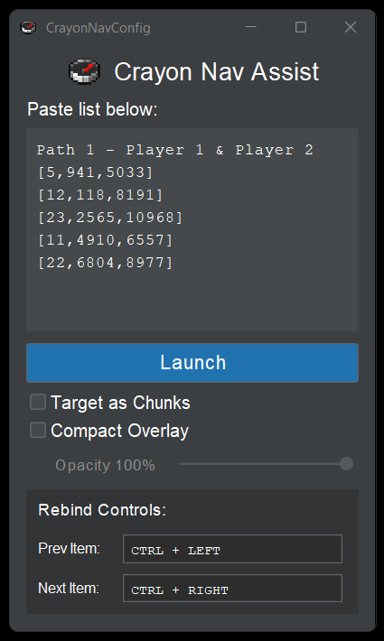
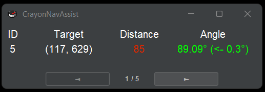

# CrayonNavAssist

Stronghold navigation for Minecraft All Portals speedruns. Paste your route, press **F3+C** in game, and it shows which way to turn and how far to go.

## Usage
1. Download the latest jar from releases and run it (needs Java 17+).
2. Find each stronghold ring using the 8 default coordinates.
3. Put your results into [CrayonAllPortals](https://github.com/CommonCrayon/CrayonAllPortals) to get your route.
4. Paste the route in and click **Launch**.
5. Press **F3+C** whenever you want the distance and angle updated.

## Config page

- **Paste list** – one `[id, x, z]` per line. Other lines are ignored. Add `"a note"` after a line to show it under the target.
- **Launch** – opens the nav window. Relaunching picks up on the same stronghold.
- **Target as Chunks** – shows chunk coordinates instead of block coordinates.
- **Compact Overlay** – hides the title bar, with adjustable opacity. Drag it to move it and right-click it to close it.
- **Rebind Controls** – click a box and press any key combo. Esc cancels.

## Nav window

- **ID** – stronghold number.
- **Target** – where to go (shown in nether coordinates while you're in the nether).
- **Distance** – blocks to the target.
- **Angle** – F3 facing to aim for, then how far to turn. Green means you're on target.
- **◄ ►** or **Ctrl + ← / →** – previous / next stronghold. Right-click the window to go back to the first one.

Settings save automatically to `%APPDATA%\CrayonNavAssist`.

## Building
Double-click `compile.bat` (needs a JDK 17+). The jar ends up in `build\libs`.
