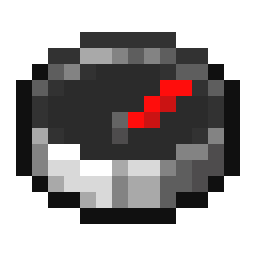

# Information

This is a tool designed for Minecraft Speedrunning in the All Portals category.
Ideally each player should download this tool as it allows for easier stronghold tracking and navigation.

## Configuration Page


### Main Textbox
In the main textbox the parseable text that you will use to set locations will be pasted.

Each line indicates a separate item and non-readable lines will simply be skipped.
In each line, the first index indicates the id, the second index is the X coordinate and the third index is the Z coordinate.
An optional note in quotes after the brackets is shown under the target, e.g. `[3, 2024, 310] "lava lake"`.

### Launch Button
Click the button to launch CrayonNavAssist with the coordinate data in the textbox.

If the target you were last on is still in the list, you carry on from that target. This covers relaunching after a crash or after fixing a typo in another line.
A list from a new run has different coordinates, so it starts from the first target.

### Target as Chunks
Shows the target as chunk coordinates instead of block coordinates.

### Compact Overlay
Removes the window border and title bar so the overlay takes up less space over the game (intended for windowed/borderless Minecraft).
- Drag anywhere on the overlay (except the buttons) to move it.
- Use the **Opacity** slider to make it see-through.
- Right-click the overlay to go back to the first target or to close it.

### Rebind Controls
This section allows the user to rebind keys to go to previous and next coordinates.
Click a box, then press the key combination you'd like to use (any key, with or without Ctrl / Shift / Alt / Win). Press Esc to cancel.
The two binds must be different.
Changes apply straight away.

### Saved Settings
The launched list, the target you're on, keybinds, toggles and window positions are saved automatically to `%APPDATA%\CrayonNavAssist\settings.properties` and restored the next time you open the tool.
Delete that file to reset everything.

## CrayonNavAssist
- The first column is the Stronghold Number.
- The second column contains the Target coordinates.
- The third column contains the Distance to target coordinates.
- The fourth column contains the Required Angle in the F3 menu and displays the Turn Amount required after pressing F3+C.

- The bottom frame allows to switch between tracking items and updates the target.
- Right-click anywhere on the window to go back to the first target.


# Usage
1. Download the latest CrayonAllPortalsJava jar from releases. It needs Java 17 or newer.
2. Run downloaded jar file.
3. You will be presented with the Configuration Page.

4. In the Configuration Page, you are already provided the best coordinates for measuring each Stronghold Ring. Thus, the first step is to find the location of each ring and note the coordinates down of each starter room.
5. After getting all 8 rings, you should input your data into the [CrayonAllPortals](https://github.com/CommonCrayon/CrayonAllPortals) tool.
6. The tool will provide you parseable text back, like below:   
```text
"0:Steve"
[3,2024,310]
[21,10085,5017]
[37,12618,6806]
[36,14063,2784]
[57,16504,5538]
[85,20213,3297]
[86,19333,6757]
[121,20924,10810]
```
7. This can be entered within the Main Textbox and launched to complete each stronghold 1 by 1 to complete a whole path. Thus allowing for easy tracking of strongholds, their order and achieving the best path for the fastest All Portals Speedrun.

# Building
Requires JDK 17 or newer.

Double-click `compile.bat`, or run it from a terminal (`compile.bat notest` skips the tests).
It picks a JDK that Gradle 8.14 can run on (Java 17-24) automatically, from JAVA_HOME, PATH, or one IntelliJ downloaded, then runs the Gradle build.

You can also run Gradle directly:
```text
gradlew build
```
The runnable jar (with all libraries included) is written to `build/libs`. Run the tests on their own with `gradlew test`.
